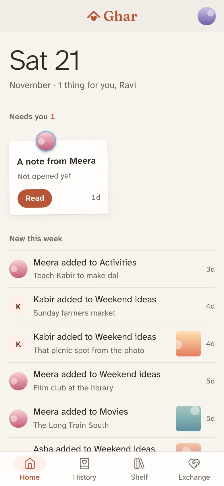
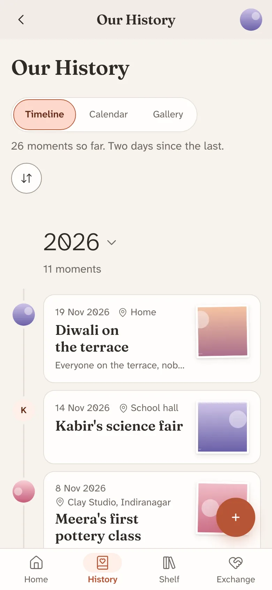
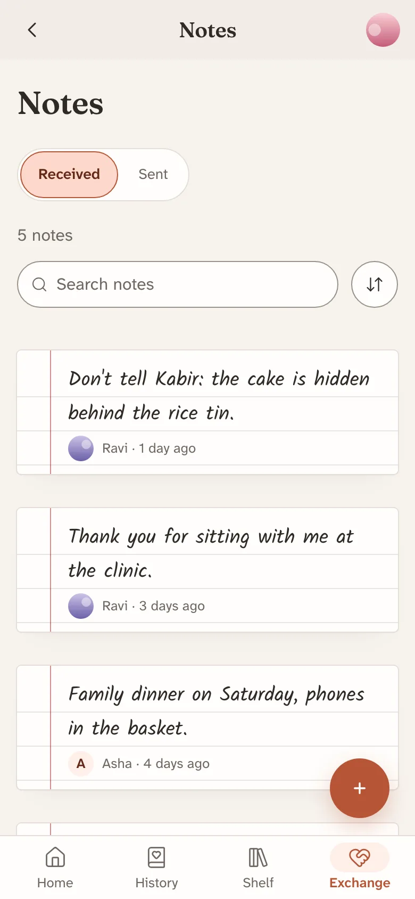
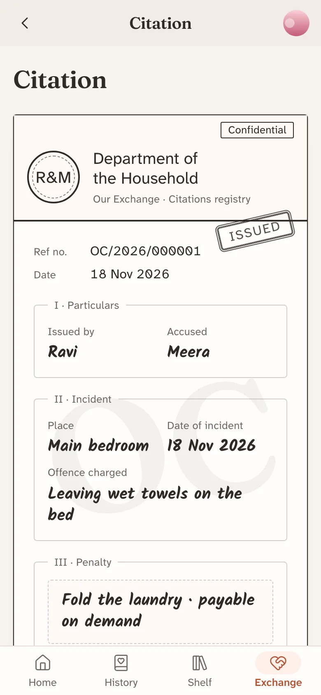

# Ghar

Ghar is a private, self-hosted web app for one family or household: a shared timeline of your photos
and moments, lists of whatever the household wants to keep (songs, films, places, books), and notes,
flowers and coupons for each other. You run it yourself with Docker, nobody joins without an invite, and your photos stay on
your own disk. It is open source under the MIT licence. "Ghar" is the Hindi and Urdu word for home.

[](https://github.com/Things-Varun-Codes/ghar/actions/workflows/ci.yml)
[](https://github.com/Things-Varun-Codes/ghar/releases)
[](https://scorecard.dev/viewer/?uri=github.com/Things-Varun-Codes/ghar)
[](./LICENSE)

<p>
  
  
  
  
</p>

<sub>The screenshots show the sample household that <code>npm run dev-setup</code> creates.</sub>

## What it is

Ghar is a web app you run yourself, for one household. Everyone logs in to the same place, and inside
it are a few small apps for the things families keep track of together:

- **Our History**: a timeline, gallery and calendar of the moments you want to remember, with photos
  and videos.
- **Our Shelf**: shared lists the household makes for itself (songs, films, places, books,
  recipes, anything), each with its own icon and its own word for done: loved, watched, visited,
  read.
- **Our Exchange**: notes and postcards (pictures made from a prompt) to one or more people, coupons someone can redeem,
  and citations. A citation is a joke traffic ticket, a mock
  official form for an offence such as leaving wet towels on the bed, with a penalty the recipient
  can mark as paid.

It also does Web Push notifications, installs to a phone's home screen as a PWA, and has short links
you can write to NFC tags.

### At a glance

- **Licence:** MIT. The first public release was 1.0.0, on 13 November 2026; later ones are in
  [`CHANGELOG.md`](./CHANGELOG.md).
- **Who it is for:** one family or household per install. Accounts are by invitation only.
- **How it runs:** one app container plus PostgreSQL 17 and a small Valkey cache, with Docker
  Compose. Images for amd64 and arm64 are at `ghcr.io/things-varun-codes/ghar`.
- **What it needs:** about 200 MB of RAM when idle, and three settings: `APP_URL`, `DB_PASSWORD`
  and `GHAR_ADMIN_EMAIL`.
- **Where photos go:** your own disk by default, or any S3-compatible bucket. They are private
  either way, behind signed links that expire within two hours.
- **Who sees what:** moments and lists are shared by everyone in the household. Notes, postcards,
  coupons and citations are seen only by the sender and the recipients, not by admins.
- **Who maintains it:** one person, in spare time.

## What it isn't

Ghar is built for one household per install. Nobody can sign up: an admin invites each person by
email. It is not multi-tenant, there is no hosted version, and it isn't trying to be a social
network. It is also the wrong tool if you want:

- **Automatic photo backup.** Photos and videos are added by hand to a moment in Our History.
  Nothing uploads your camera roll; use a self-hosted photo library for that.
- **Chores, shopping lists or a shared calendar.** The calendar in Our History shows the moments you
  have recorded, not appointments. Use a family organiser or a home dashboard for those.
- **End-to-end encryption.** Mail between members is hidden from other members, admins included,
  but whoever runs the server can read the database. Sign-in is an email address and a password,
  plus a code from an authenticator app for anyone who turns on two-step sign-in.
- **An export button.** A backup is a database dump plus the media folder or bucket.

The interface is in English.

Built with Laravel 13, Inertia 3, React 19, TypeScript, Tailwind 4 and PostgreSQL 17. Each mini app
is its own self-contained module, so adding another one doesn't mean touching the rest.

## Self-hosting with Docker Compose

You need Docker. Ghar runs on amd64 and arm64, including a Raspberry Pi 4 or 5, uses about 200 MB of
RAM when idle, and keeps photos on your own disk unless you choose a bucket.

```sh
mkdir ghar && cd ghar
curl -LO https://raw.githubusercontent.com/Things-Varun-Codes/ghar/main/docker-compose.selfhost.yml
curl -L -o .env https://raw.githubusercontent.com/Things-Varun-Codes/ghar/main/.env.selfhost.example
# fill in APP_URL, DB_PASSWORD and GHAR_ADMIN_EMAIL in .env, then:
docker compose -f docker-compose.selfhost.yml up -d
docker compose -f docker-compose.selfhost.yml logs app | grep -A1 "Admin account created"
```

Log in at <http://localhost:8080> with the password from the log and invite your family from
Admin, Invites. [`DEPLOY.md`](./DEPLOY.md) covers HTTPS with Caddy, mail, S3-compatible storage,
backups, upgrades and running behind Cloudflare.

Ghar works without any outside accounts. Optional extras: an image model of your choice for
postcard pictures, and any Sentry-compatible error tracker.

## What leaves your server

Ghar has no analytics and doesn't report back to anyone. A running install contacts the outside only
for these:

- **Mail**: invites, password resets and email-change links go through the SMTP provider or Resend
  account you set up.
- **Web Push**: notifications travel through each browser's own push service, once someone turns
  them on.
- **Links in Our Shelf**: when someone pastes a link, the server reads that page for its name and
  picture (the page's own oEmbed, Open Graph or title tags), follows a short map link to find its
  coordinates, and fetches the picture to show it. Browsers only ever talk to your install: Ghar
  serves the picture itself, from a small cache that may be thrown away. These fetches go only to
  public addresses, never into your own network.
- **Place search**: what someone types in a moment's Location field is sent
  from the server to Photon, an OpenStreetMap search (`photon.komoot.io`, or your own via
  `PHOTON_URL`). It sees only the words typed, never who typed them.
- **Map**: Our History's map is drawn from OpenFreeMap tiles (`tiles.openfreemap.org`, or your own
  via `MAP_TILES_URL`), which the server fetches. The tile host sees which areas were viewed, never
  who viewed them.
- **Password check**: when someone sets a password, it is checked against a public list of breached
  passwords. Only the first five characters of its hash are sent.

Off until you set them up: Cloudflare Workers AI, an error tracker and an
S3-compatible bucket for media. Fonts are downloaded when the image is built and served by Ghar
itself.

## Questions

**Can we keep lists other than songs and films?** Yes. Our Shelf holds whatever lists your
household makes. Each list has a name, an icon and its own word for done, and every item can have
notes, a link, a picture and a place. Anyone can make a list; its maker or an admin can change it.
Its maker can delete it while everything in it is theirs; once someone else has added to it,
deleting it takes an admin.

**How do I add or remove a person?** An admin sends an invitation from Admin, Invites. The link
works once and expires after 7 days; resending the invite replaces it. To remove someone, an admin
deletes the account from Admin, Users. Ghar won't delete a person who still owns Our Shelf items or
Our Exchange mail, and says what is in the way.

**Does it work offline?** No. Its service worker only handles notifications, so every screen needs
a connection to your server.

**Is there a phone app?** Not in an app store. Ghar installs to the home screen from the browser on
Android and iOS, opens in its own window and can send Web Push notifications. This needs HTTPS, and
on iOS notifications work only once the app is on the Home Screen. NFC tags tapped on an iPhone open
in Safari rather than in the installed app.

## Local development

You need PHP 8.4 or newer, Composer, Node 22.12 or newer, and Docker. Then:

```sh
npm run dev-setup
composer dev
```

The first command checks your tools, writes `.env`, starts Postgres and Mailpit, installs everything
and fills the database with a sample household. It's safe to run again. The second serves the app at
<http://127.0.0.1:8000>. To put the sample data back the way it started, run `npm run dev-reset`.

Every account uses the password `ghar-local-dev`:

| Account              | Who                     |
| -------------------- | ----------------------- |
| `admin@example.test` | Asha, the admin         |
| `ravi@example.test`  | Ravi, an adult          |
| `meera@example.test` | Meera, an adult         |
| `kabir@example.test` | Kabir, the youngest one |

Outgoing mail shows up in Mailpit at <http://127.0.0.1:8025>.

## Testing

```sh
npm test                 # unit tests
php artisan test         # backend tests, against Postgres
npm run smoke            # opens every page in a headless browser
npm run smoke-loadmore   # breaks pagination on purpose and checks the recovery
npm run smoke-mcp        # serves the sample data for testing by hand
```

CI runs the first four on every pull request, and `npm run verify` runs everything CI checks in
one go. [`CONTRIBUTING.md`](./CONTRIBUTING.md) explains what each one is for.

## Contributing

Bug reports and pull requests are welcome. See [`CONTRIBUTING.md`](./CONTRIBUTING.md), including how
to add a mini app, and the [code of conduct](./CODE_OF_CONDUCT.md). Questions go in
[Discussions](https://github.com/Things-Varun-Codes/ghar/discussions). [`CLAUDE.md`](./CLAUDE.md) has the architecture notes and conventions, written for
coding agents and just as useful to people.

## Roadmap

[`ROADMAP.md`](./ROADMAP.md) lists what's planned next, and the trade-offs made on purpose. Releases and upgrade notes are in [`CHANGELOG.md`](./CHANGELOG.md).

## Security

Please don't open a public issue for a vulnerability. [`SECURITY.md`](./SECURITY.md) says how to
report one and what Ghar does and doesn't protect against.

## License

[MIT](./LICENSE). The fonts Ghar serves keep their own licences, listed in
[`THIRD_PARTY_NOTICES.md`](./THIRD_PARTY_NOTICES.md).
