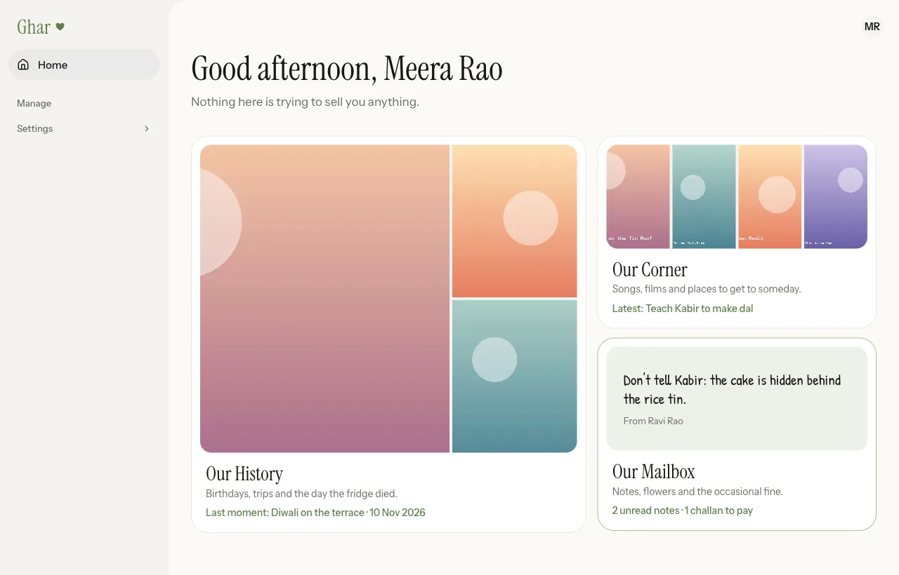
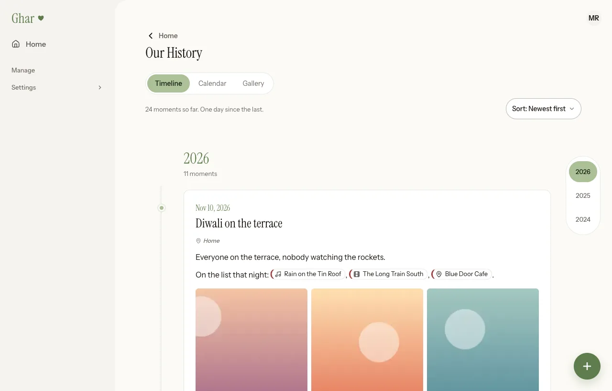
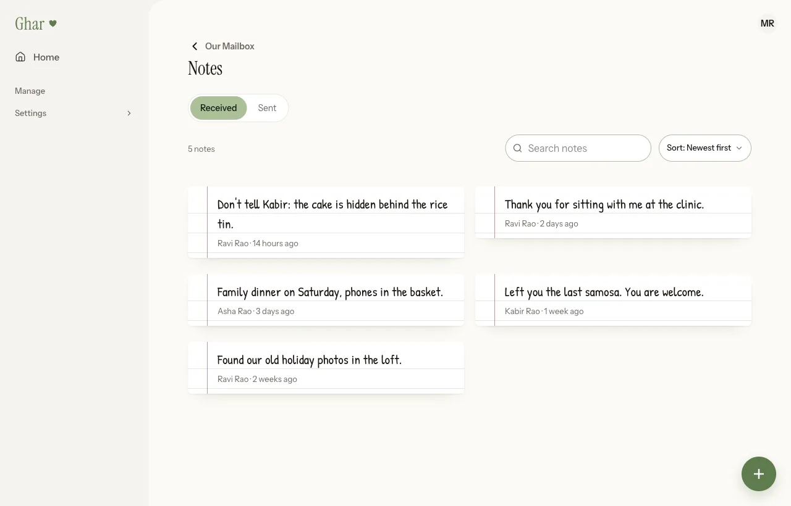
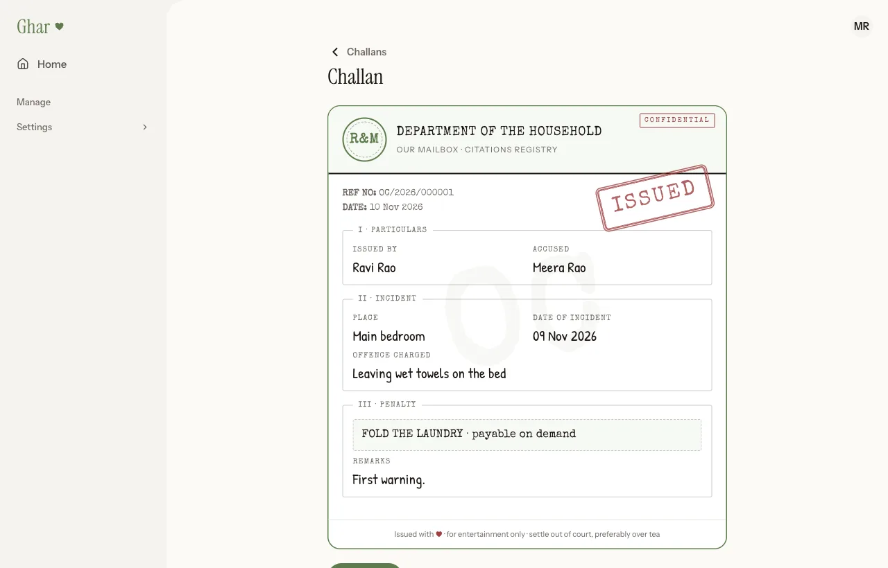

# Ghar

[](https://github.com/Things-Varun-Codes/ghar/actions/workflows/ci.yml)
[](https://github.com/Things-Varun-Codes/ghar/releases)
[](https://scorecard.dev/viewer/?uri=github.com/Things-Varun-Codes/ghar)
[](./LICENSE)

A private home on the web for your family. "Ghar" is the Hindi and Urdu word for home.

<p>
  
  
  
  
</p>

<sub>The screenshots show the sample household that <code>npm run dev-setup</code> creates.</sub>

## What it is

Ghar is a web app you run yourself, for one household. Everyone logs in to the same place, and inside
it are a few small apps for the things families keep track of together:

- **Our History**: a timeline, gallery and calendar of the moments you want to remember, with photos
  and videos.
- **Our Corner**: shared lists of songs, movies, places and things to do, and a way to mark what
  you've loved, watched or visited.
- **Our Mailbox**: notes and bouquets of flowers to one or more people, joke traffic tickets
  ("challans") and coupons someone can redeem.

It also does Web Push notifications, installs to a phone's home screen as a PWA, and has short links
you can write to NFC tags.

## What it isn't

Ghar is built for one household per install. Nobody can sign up: an admin invites each person by
email. It is not multi-tenant, there is no hosted version, and it isn't trying to be a social
network. Each mini app is its own self-contained module, so adding another one doesn't mean touching
the rest.

Built with Laravel 13, Inertia 3, React 19, TypeScript, Tailwind 4 and PostgreSQL 17.

## Self-hosting

You need Docker. Ghar runs on amd64 and arm64 in about 200 MB of RAM, and photos stay on your own
disk unless you choose a bucket.

```sh
mkdir ghar && cd ghar
curl -LO https://raw.githubusercontent.com/Things-Varun-Codes/ghar/main/docker-compose.selfhost.yml
curl -L -o .env https://raw.githubusercontent.com/Things-Varun-Codes/ghar/main/.env.selfhost.example
# fill in APP_URL, DB_PASSWORD and GHAR_ADMIN_EMAIL in .env, then:
docker compose -f docker-compose.selfhost.yml up -d
docker compose -f docker-compose.selfhost.yml logs app | grep -A1 "Admin account created"
```

Log in at <http://localhost:8080> with the password from the log and invite your family from
Admin, Invites. [`DEPLOY.md`](./DEPLOY.md) covers HTTPS with Caddy, mail, S3-compatible storage,
backups, upgrades and running behind Cloudflare.

Optional extras: Google Places for location search (without it you type places in), Cloudflare
Workers AI for the flower pictures, and any Sentry-compatible error tracker.

## Local development

You need PHP 8.4 or newer, Composer, Node 22 or newer, and Docker. Then:

```sh
npm run dev-setup
composer dev
```

The first command checks your tools, writes `.env`, starts Postgres and Mailpit, installs everything
and fills the database with a sample household. It's safe to run again. The second serves the app at
<http://127.0.0.1:8000>. To put the sample data back the way it started, run `npm run dev-reset`.

Every account uses the password `ghar-local-dev`:

| Account              | Who                     |
| -------------------- | ----------------------- |
| `admin@example.test` | Asha, the admin         |
| `ravi@example.test`  | Ravi, an adult          |
| `meera@example.test` | Meera, an adult         |
| `kabir@example.test` | Kabir, the youngest one |

Outgoing mail shows up in Mailpit at <http://127.0.0.1:8025>.

## Testing

```sh
npm test                 # unit tests
php artisan test         # backend tests, against Postgres
npm run smoke            # opens every page in a headless browser, in both themes
npm run smoke-loadmore   # breaks pagination on purpose and checks the recovery
npm run smoke-mcp        # serves the sample data for testing by hand
```

CI runs the first three on every pull request. [`CONTRIBUTING.md`](./CONTRIBUTING.md) explains what
each one is for.

## Contributing

Bug reports and pull requests are welcome. See [`CONTRIBUTING.md`](./CONTRIBUTING.md), including how
to add a mini app, and the [code of conduct](./CODE_OF_CONDUCT.md). Questions go in
[Discussions](https://github.com/Things-Varun-Codes/ghar/discussions). [`CLAUDE.md`](./CLAUDE.md) has the architecture notes and conventions, written for
coding agents and just as useful to people.

## Roadmap

[`ROADMAP.md`](./ROADMAP.md) lists what's planned next, and the trade-offs made on purpose. Releases and upgrade notes are in [`CHANGELOG.md`](./CHANGELOG.md).

## Security

Please don't open a public issue for a vulnerability. [`SECURITY.md`](./SECURITY.md) says how to
report one and what Ghar does and doesn't protect against.

## License

[MIT](./LICENSE). The fonts Ghar serves keep their own licences, listed in
[`THIRD_PARTY_NOTICES.md`](./THIRD_PARTY_NOTICES.md).
